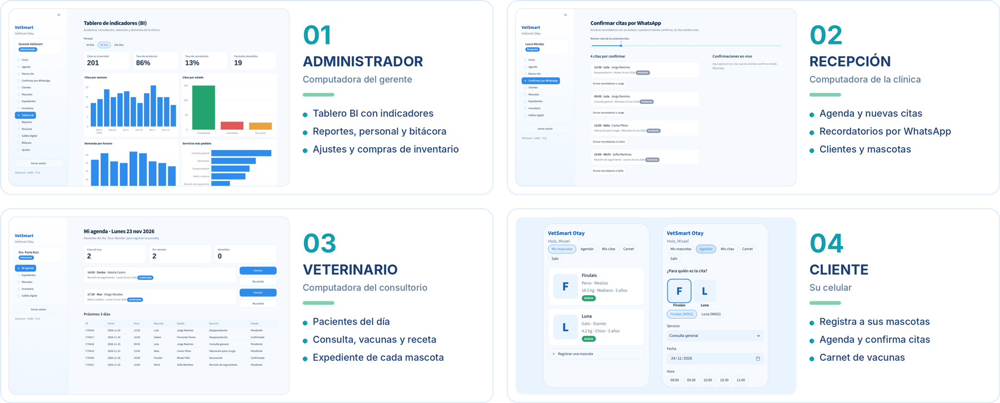
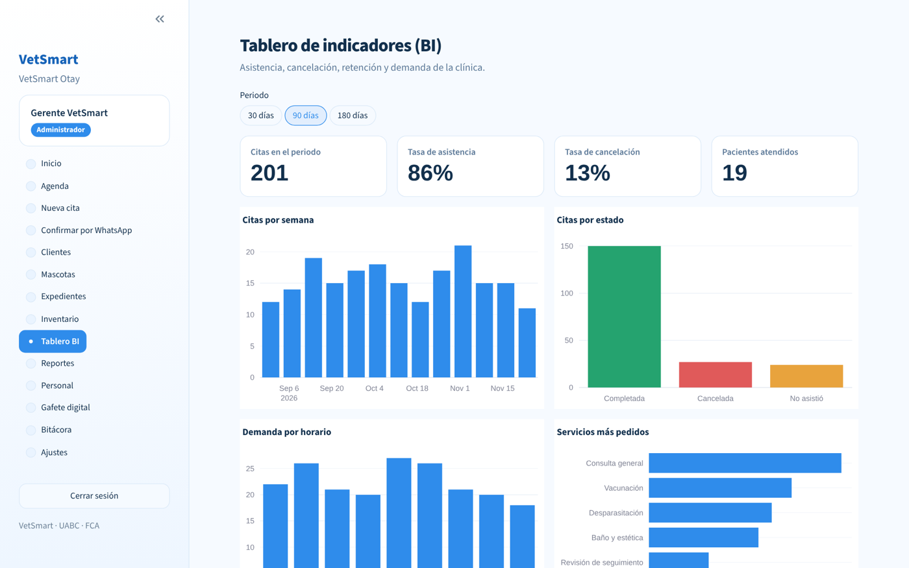
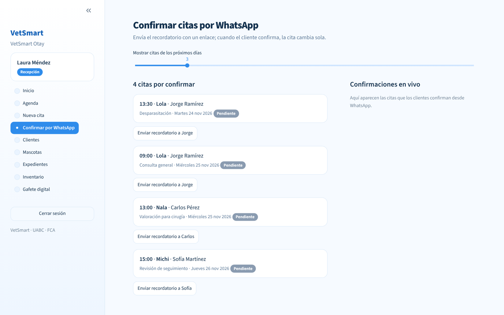
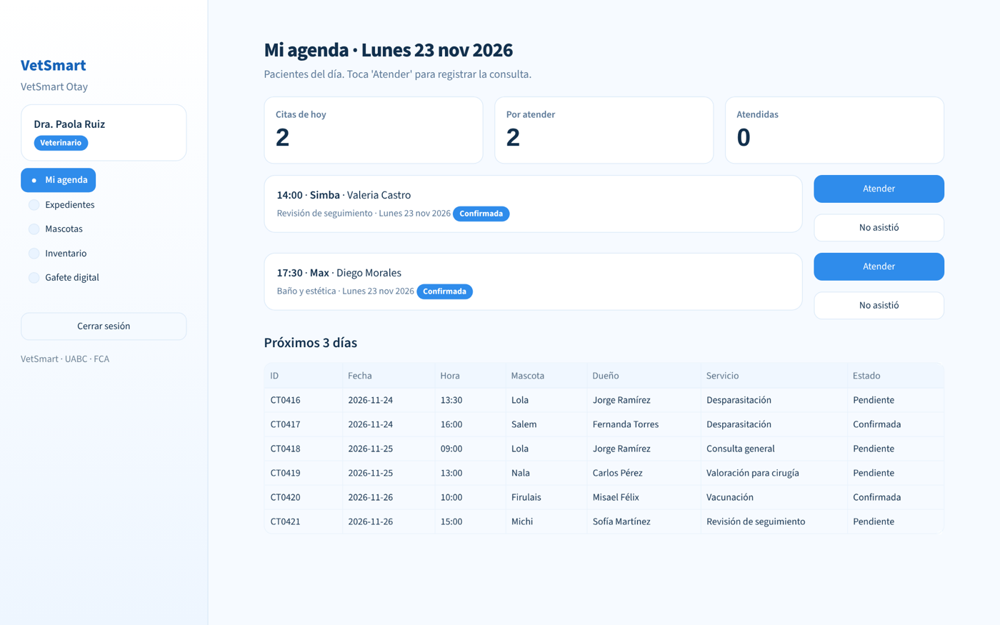
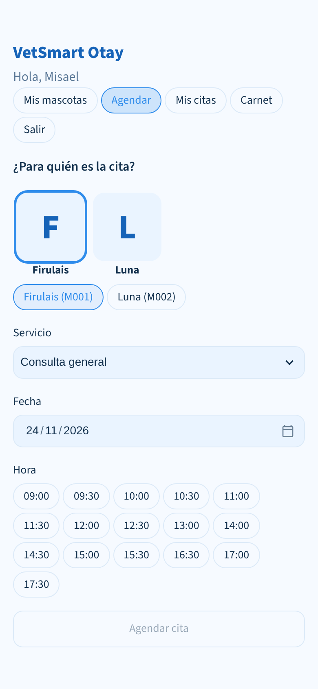

# VetSmart — Clínica Veterinaria Inteligente

Sistema para una clínica veterinaria de Tijuana: agenda inteligente, confirmación de citas por WhatsApp, expediente y carnet de vacunas digital, inventario con alertas y tablero de indicadores (BI).

> Proyecto para la materia **Modelo de Negocio e Innovación** · UABC · FCA.
> Lema: *"Salud al día para tu mascota, tranquilidad total para ti."*



## Características

- **Un solo archivo** (`app.py`) hecho con Python y Streamlit.
- **Sin base de datos:** los datos viven en listas y diccionarios de Python y se respaldan en un archivo `.pkl`.
- **Datos compartidos:** recepción, veterinario y clientes ven la misma información al mismo tiempo.
- **Cuatro tipos de usuario:**
  - **Administrador:** ve todo. Es el único que puede ver el tablero BI, descargar reportes CSV, dar de alta personal, revisar la bitácora, cambiar ajustes y registrar compras de inventario.
  - **Recepción:** agenda, nuevas citas, confirmación por WhatsApp, clientes, mascotas y expedientes. El inventario solo lo consulta.
  - **Veterinario:** agenda del día, consultas, vacunas, expedientes e inventario. Al aplicar un medicamento, se descuenta solo del inventario.
  - **Cliente (celular):** crea su cuenta, registra mascotas con foto, agenda citas, confirma o cancela (mínimo 48 h antes) y ve el carnet de vacunas.
- **Página pública `?cita=...`:** el cliente la abre desde WhatsApp y confirma su cita sin iniciar sesión.

## Capturas

| Administrador (tablero BI) | Recepción (WhatsApp) |
|---|---|
|  |  |

| Veterinario (agenda del día) | Cliente (celular) |
|---|---|
|  |  |

## Tecnologías

Python 3.13 · Streamlit · pandas · Plotly · Pillow

## Usuarios de prueba

| Rol | Usuario | Contraseña |
|---|---|---|
| Administrador | `admin` | `admin123` |
| Recepción | `recepcion` | `recep123` |
| Veterinario | `veterinario` | `vet123` |
| Cliente | `6641234567` | `1234` |

## Correr en tu computadora

```bash
pip install -r requirements.txt
streamlit run app.py
```

## Publicarlo en internet (Streamlit Community Cloud, gratis)

1. Sube esta carpeta a un repositorio **público** de GitHub.
2. Entra a **share.streamlit.io** e inicia sesión con tu cuenta de GitHub.
3. Haz clic en **Create app** y elige **Deploy a public app from GitHub**.
4. Elige el repositorio, la rama `main` y el archivo `app.py`.
5. Escribe la dirección que quieras, por ejemplo `vetsmart-uabc`.
6. Haz clic en **Deploy**. En 2 o 3 minutos queda en `https://vetsmart-uabc.streamlit.app`.

Esa dirección es fija y no necesita que tu computadora esté prendida. Cada vez que hagas `git push`, la app se actualiza sola.

> **Nota:** si nadie entra en varios días, la app se "duerme". Al abrirla aparece un botón para despertarla y tarda unos segundos. Ábrela antes de presentar.
